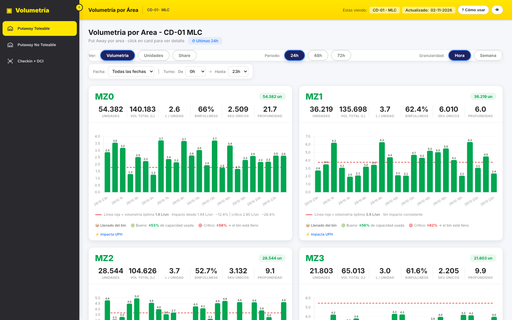
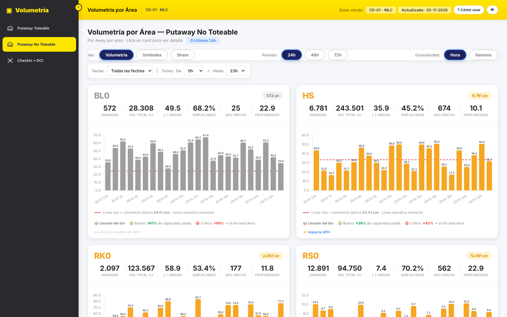
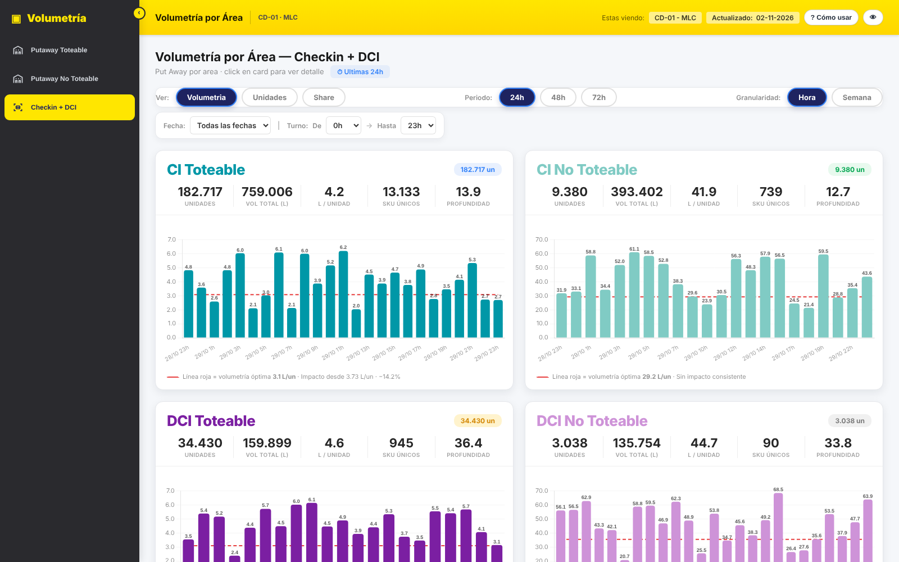

# Volumetría por Área — Dashboard de centro de distribución

Dashboard que muestra, **hora a hora**, la volumetría (litros por unidad) de lo que entra y se guarda en cada área de un centro de distribución, y un workflow **n8n** que calcula los datos en **BigQuery** y los publica automáticamente cada hora.

> Los nombres de tablas, proyectos, hosts y centro de distribución están **anonimizados** y los datos del demo son **sintéticos**.



## ¿Qué muestra?

| Vista | Áreas | Para qué sirve |
|---|---|---|
| **Putaway Toteable** | MZ0 – MZ3, HV3 | Mezanine y alta velocidad: productos pequeños que viajan en tote |
| **Putaway No Toteable** | BL0, HS, RK0, RS0 | Bulky, estanterías y racks: productos grandes |
| **Checkin + DCI** | CI / DCI Toteable y No Toteable | Recepción (checkin y direct checkin) |

Para cada área se ve:

- **KPIs:** unidades, volumen total (L), litros por unidad, binfullness (% de llenado del bin), SKUs únicos y profundidad (unidades por SKU).
- **Gráfico por hora** con 3 modos: *Volumetría* (L/un), *Unidades* y *Share* (participación del área).
- **Línea roja de volumetría óptima:** el umbral desde el cual una volumetría más alta empieza a bajar la productividad (UPH).
- **Filtros:** período 24h / 48h / 72h, granularidad hora o semana, fecha y rango de turno.

| Putaway No Toteable | Checkin + DCI |
|---|---|
|  |  |

## Arquitectura

```
 ┌──────────────┐   cada hora (min 3)   ┌───────────────────────┐
 │ n8n Schedule │ ────────────────────▶ │ BigQuery              │
 └──────────────┘                        │ 1. VOLUMETRIA3: crea  │
                                         │    VOLUMETRIA_SEMANA  │
                                         │ 2. VOLUMETRIA1: une   │
                                         │    putaway+CI+DCI     │
                                         └──────────┬────────────┘
                                                    │ filas JSON
                                         ┌──────────▼────────────┐
                                         │ Aggregate → API       │
                                         │ upload-url → PUT      │
                                         │ → publish (revision)  │
                                         └──────────┬────────────┘
                                                    ▼
                                         dashboard/index.html
```

## Estructura

```
dashboard/
  index.html            Dashboard (HTML + CSS + JS, sin build)
  data/sample-data.js   Generador de datos sintéticos para el demo
  vendor/               Chart.js 4.4.7 (licencia MIT)
n8n/
  workflow.json         Workflow para importar en n8n
sql/
  01_volumetria_semana_putaway.sql   Cálculo putaway por área/hora
  02_lectura_volumetria_dashboard.sql Consulta final que lee el dashboard
docs/img/               Capturas
```

## Cómo verlo

**Opción rápida:** abre `dashboard/index.html` en el navegador. Usa los datos de ejemplo.

**Con datos reales:**
1. En `dashboard/index.html`, elimina la línea `<script src="data/sample-data.js"></script>`.
2. Deja el resultado de `sql/02_lectura_volumetria_dashboard.sql` como `dashboard/data/volumetria.json` (un arreglo de filas).
3. Sírvelo por HTTP, por ejemplo: `cd dashboard && python -m http.server 8000` → http://localhost:8000

### Formato de cada fila

```json
{
  "FECHA": "2026-10-29", "HORA": 14, "AREA": "MZ0",
  "SKUs_Distintos": 120, "Cantidad_Total_Unidades": 2600,
  "Volumen_Total_Litros": 5720.5, "Volumetria_Litros_Por_Unidad": 2.2,
  "Binfullness": 64.0
}
```

## Workflow n8n

1. En n8n: **Workflows → Import from file** → `n8n/workflow.json`.
2. Reemplaza los marcadores:
   - `YOUR_GCP_PROJECT_ID` y las tablas `your-project.*` por tus tablas de BigQuery.
   - `YOUR_DASHBOARD_HOST` / `YOUR_DOCUMENT_ID` por el destino donde publicas los datos.
   - `REPLACE_WITH_YOUR_CREDENTIAL_ID`: crea tus credenciales (Google OAuth2 y Bearer token) y asígnalas a cada nodo.
3. Activa el workflow; corre cada hora en el minuto 3.

## Tecnologías

HTML · CSS · JavaScript · Chart.js · n8n · Google BigQuery (SQL)

## Autor

Julio Novoa
